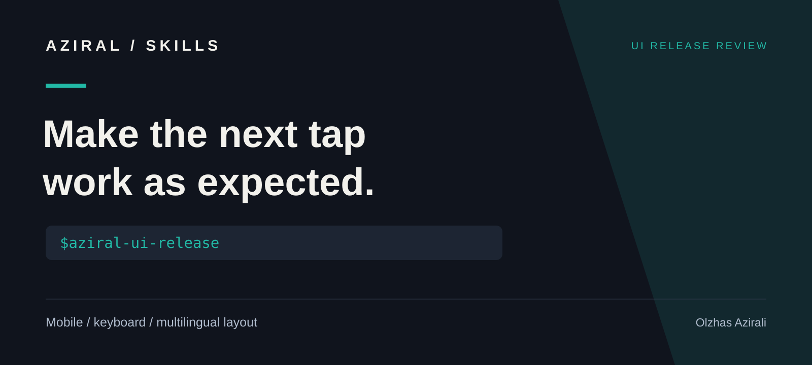

# AZIRAL UI Release Review

**An independent AZIRAL skill by Olzhas Azirali.** This repository is not affiliated with or endorsed by Paul Bakaus. The original [Impeccable by Paul Bakaus](https://github.com/pbakaus/impeccable) is a separate project. This repository contains original AZIRAL review instructions and templates, with no upstream code, command catalog, or visual assets.



[Русская версия](README.ru.md) | [Skill](skills/aziral-ui-release/SKILL.md) | [Example report](examples/release-review-example.md) | [MIT license](LICENSE)

Review what a person can actually do before shipping an interface. The workflow connects a reproducible defect to its user consequence, an appropriate fix, and evidence that the fix worked.

## Install

```bash
npx skills add azirali/impeccable --skill aziral-ui-release
```

For manual installation, copy `skills/aziral-ui-release` into your agent's skills directory. In Codex, invoke `$aziral-ui-release`. This is an instruction-only skill; it does not install the upstream Impeccable engine, detector, or hooks.

## Try it

```text
Use $aziral-ui-release to review our contact flow in Russian,
English, and Kazakh before release. Check the phone menu, keyboard
path, validation, and long text. Report reproducible issues with
user impact and evidence. Do not change unrelated pages.
```

## What it checks

| Area | Useful evidence |
| --- | --- |
| Multilingual layout | Actual RU/EN/KK strings, font coverage, wrapping, locale routing |
| Touch input | Tap targets, overlapping controls, scroll ownership, cancellation |
| Keyboard input | Focus order, visible focus, menus, dialogs, equivalent actions |
| Forms | Labels, errors, retained input, loading, success and failure behavior |
| Motion and layout | Reduced motion, stable controls, narrow-screen overflow |

The review stays within the requested scope. It can be read-only, or it can fix findings when the user has requested changes. A visual preference is kept separate from a demonstrated defect.

## Delivery

Use the included [review template](skills/aziral-ui-release/references/review-template.md) to record target, version, environment, findings, and verification. The [example report](examples/release-review-example.md) shows how to write actionable findings without inventing passed checks.

If the original Impeccable detector is already available, its output can be supporting evidence. Browser reproduction and user impact determine the review finding; a clean detector result does not establish that an interaction works.

## Contribute

Share a minimal reproduction, the affected language and device, expected behavior, actual behavior, and a useful capture. Remove private data before opening an issue. Contributions that clarify severity, reduce false positives, or cover real localization failures are welcome.

Created by [Olzhas Azirali](https://github.com/azirali), founder of [AZIRAL](https://aziral.com). Original files in this repository use the [MIT license](LICENSE). Separate tools retain their own licenses.

## More AZIRAL skills

[HyperFrames workflows](https://github.com/azirali/hyperframes) · [Remotion promos](https://github.com/azirali/remotion) · [Brand frontend](https://github.com/azirali/taste-skill) · [UI release review](https://github.com/azirali/impeccable)

If this workflow helps your work, a star helps other developers discover it.
